# Projeto DevSecOps ADA - Policy as Code, SBOM e Supply Chain Security

## Projeto Final do Curso — Raio-X da Cadeia de Suprimentos
Este é o projeto final de todo o módulo CY-SE-013, não o laboratório integrador da Aula 8. O projeto da Aula 8 (respostas/Aula_08/api-pagamentos/) continua existindo como o laboratório daquela aula específica; este aqui é deliberadamente mais simples, pensado para quem tem pouco tempo e ainda assim precisa demonstrar, de ponta a ponta, por que cada camada do curso importa.

## Objetivo
Pegar uma aplicação pequena (pode ser de brinquedo) e mostrar um "antes e depois": sem nenhum controle de supply chain security ela está vulnerável; aplicando o que foi visto nas 9 aulas, um ataque simples é bloqueado ou evidenciado. O impacto vem do contraste, não da quantidade de ferramentas.

## Formato
Individual ou em dupla. \
Não é necessário cluster Kubernetes, Dependency-Track ou pipeline de CI completo — um Dockerfile de poucas linhas já é suficiente como "aplicação". \
Esforço esperado: algumas horas, divididas nos 4 passos abaixo.

## Passos
Camada do curso	O que fazer	Aulas relacionadas

1	Política	Escrever uma regra Rego simples (ex.: bloquear container rodando como root, ou exigir imagem de um registry aprovado) e testá-la com opa eval/conftest.	1–3 \

2	Inventário	Gerar o SBOM da imagem com Syft (1 comando) e rodar Trivy até achar uma vulnerabilidade real.	4–5 \

3	Cadeia	Escolher um cenário de ataque visto na Aula 6 (ex.: dependência maliciosa, imagem adulterada) e assinar a imagem com Cosign (modo keyless), mostrando como a verificação detectaria a adulteração.	6–7 \

4	Compliance	Responder em meia página: "se essa cadeia fosse atacada amanhã, que evidência eu teria para provar o que aconteceu?"	8–9

## Entregáveis
Pasta (ou repositório pequeno) com: Dockerfile, a policy Rego, o SBOM gerado, o print do resultado do Trivy e a assinatura/verificação do Cosign.
Meia página (ou 1 slide) de "mapa de ameaças": onde um atacante entraria e qual controle do curso bloqueia ou evidencia isso.

## Apresentação (5 minutos)
1- Antes (1 min) — mostra a imagem/app sem nenhum controle.

2- Ataque (1 min) — simula o problema (root, imagem não assinada, vulnerabilidade conhecida).

3- Depois (2 min) — mostra o gate (Rego) ou a verificação (Cosign) bloqueando ou evidenciando o problema.

4- Por que importa (1 min) — conecta com um caso real visto na Aula 6 (ex.: SolarWinds, xz-utils)

## Avaliação
Checklist binário de 5 itens, sem rubrica de 0–100:

 Escreveu e testou a policy Rego.

 - [ ] Gerou o SBOM. 
 - [ ] Encontrou e registrou 1 vulnerabilidade real. 
 - [ ] Assinou/verificou com Cosign. 
 - [ ] Conectou o exercício com um caso real de ataque à cadeia de suprimentos.

# Desenvolvimento
- Criação de uma aplicação base (api python com flask depreciado);
- Criação de uma imagem docker para rodar a aplicação com um Dockerfile vulnerável pelo comando: `docker build -t flask-vulneravel:1.0 .`
Após a criação da imagem podemos rodar a mesma pelo comando `docker run -d -p 5000:5000 --name meu-flask-vulneravel flask-vulneravel:1.0`
- Criação de testes iniciais da aplicação insegura com relatórios sbom.json feito com o comando na raíz do projeto `syft dir:. -o json > sbom.json` e trivy-config-report.json pelo comando `trivy config Dockerfile --format json --output trivy-config-report.json` .Ao ler a saída do trivy sabe-se que a aplicação têm problemas
- Criação de regras policy com script security.rego e testes com security_test.rego validando imagem com usuário não root e testes para evitar imagem com a tag 'latest', criação de um novo Dockerfile.secure respeitando as regras disponibilizadas por security.rego
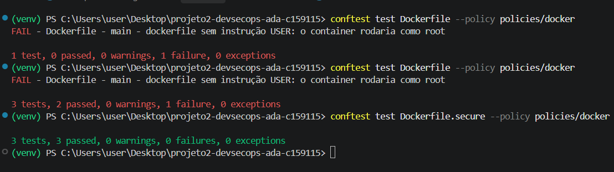
- Criação da pipeline com implementação inicial até fase 2 Inventário
- Teste inicial da pipeline com Dockerfile inseguro - evidência de falha ao usar imagem com usuário ROOT
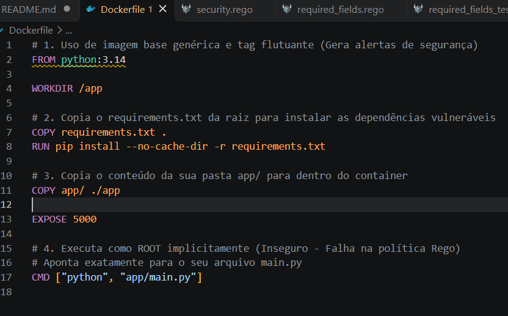
e na pipeline:
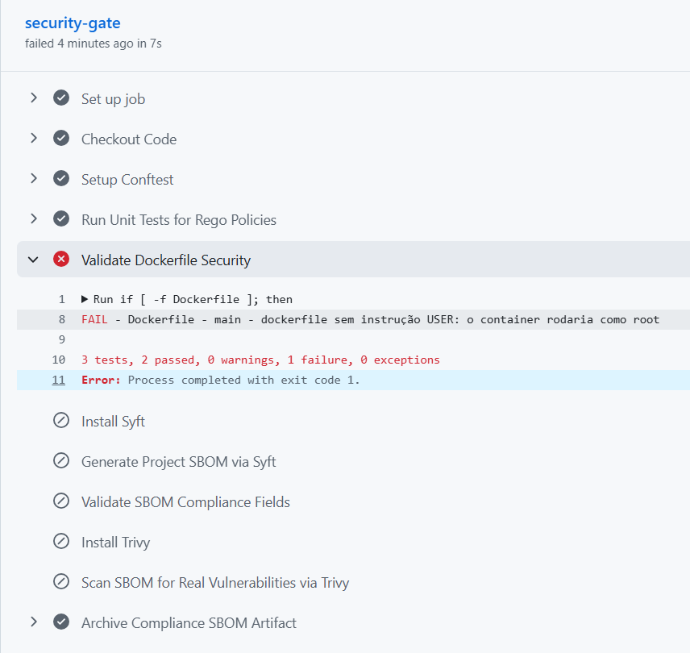
evidencia da aplicação da policy .rego:
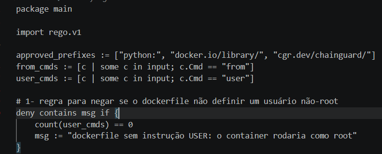
- Fazendo a mudança na nomeclatura do Dockerfile.secure para Dockerfile e mudando o nome do Dockerfile (inseguro) para Dockerfile.antigo, a esteira reconheceu o novo Dockerfile para analisar e tivemos esses retornos:
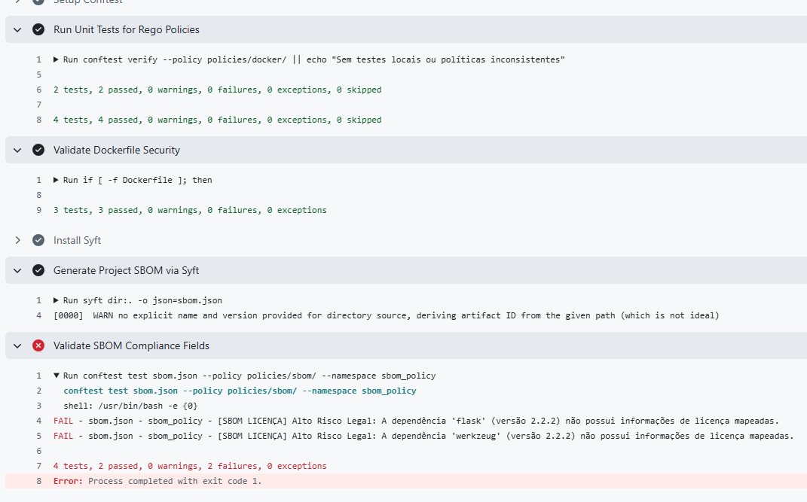
Os testes de security.rego atestaram a conformidade, porém em required_fields.rego houve a indicação de inconformidade de:
FAIL - sbom.json - sbom_policy - [SBOM LICENÇA] Alto Risco Legal: A dependência 'flask' (versão 2.2.2) não possui informações de licença mapeadas.
FAIL - sbom.json - sbom_policy - [SBOM LICENÇA] Alto Risco Legal: A dependência 'werkzeug' (versão 2.2.2) não possui informações de licença mapeadas.
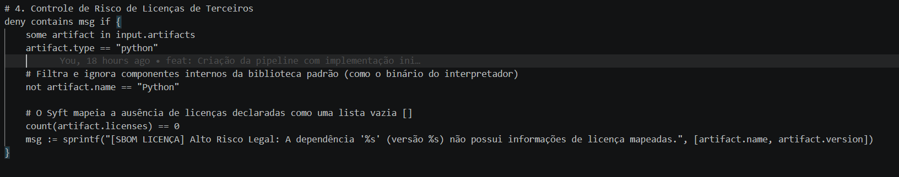
- Dockerfile atualizado:
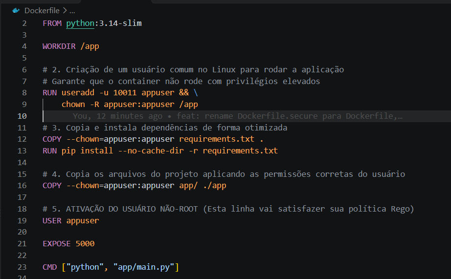
- foi mapeada uma dependencia transitiva do Flask:
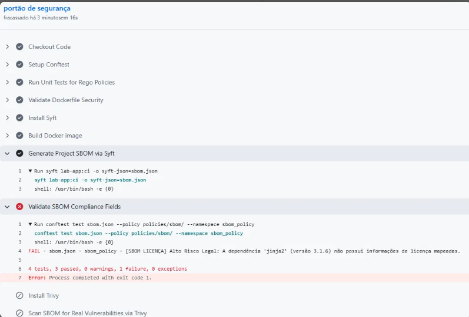
Será feito um debug para catalogar dependências transitivas para colocar como exceção para não travar os passos seguintes
- No pipeline capturada essa dependencia transitiva:
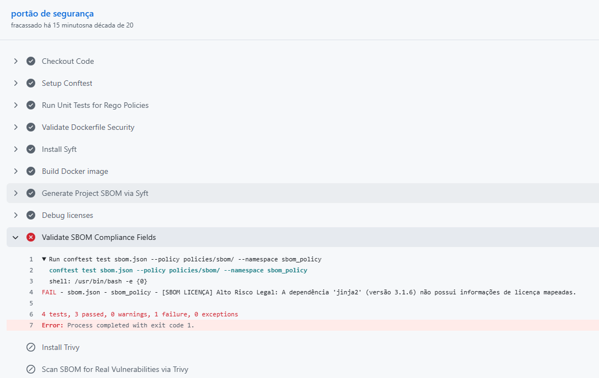
Feito tratamento dessa exceção em required_fields.rego
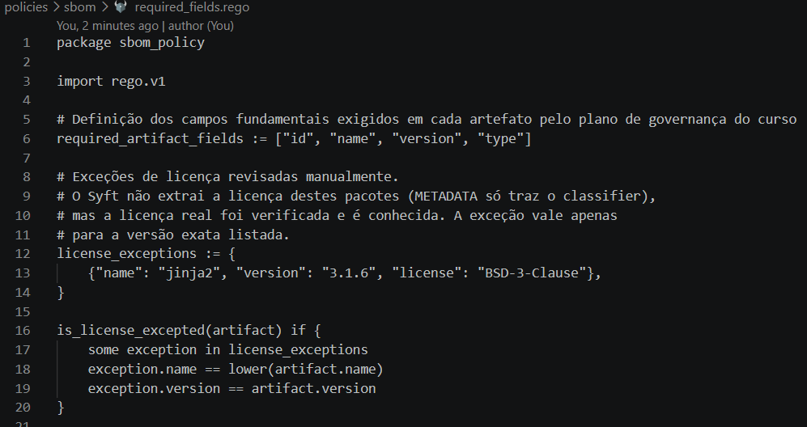
- Feito um ajuste de checagem de versão do Trivy e geração de um segundo SBOM compatível para o Trivy interpretar, na saída da esteira tivemos `Detected SBOM format    format="unknown"
FATAL ... SBOM decode error: unknown scanning is not yet supported`
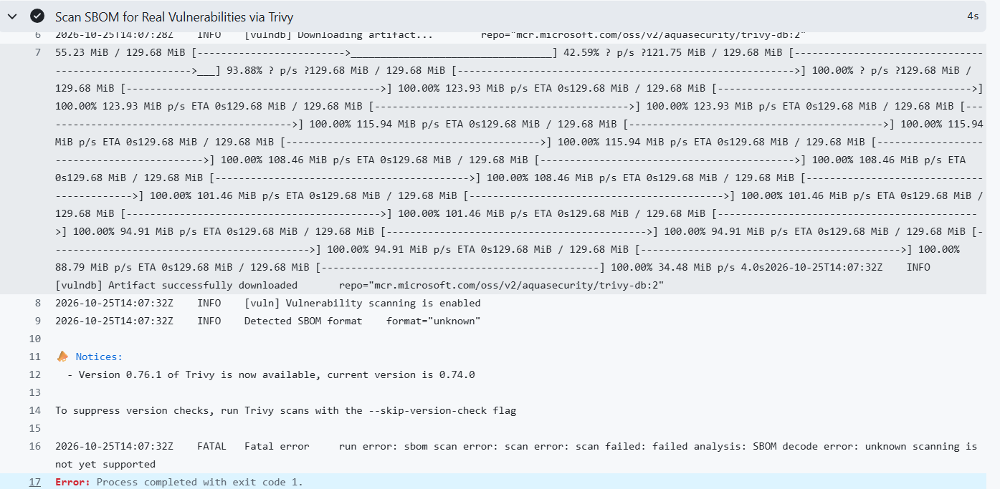
- Nesse projeto python foi instalado via pip o pip-audit e abaixo temos apontamentos de vulnerabilidades desse projeto:
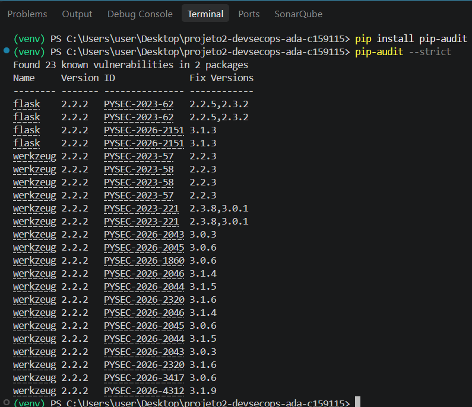
No pipeline também temos evidências de vulnerabilidades pelo sbom no formato cyclonedx
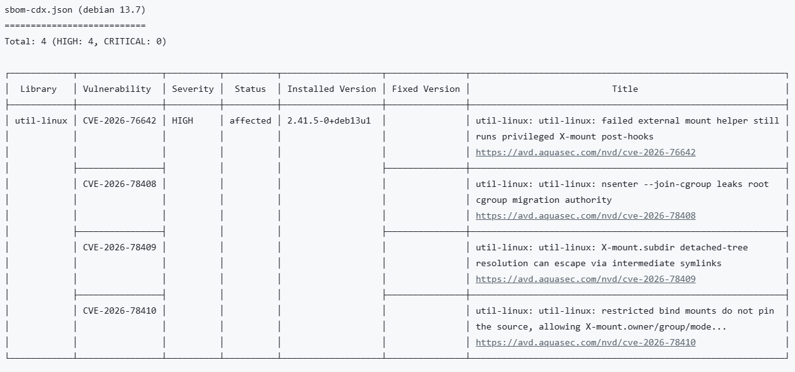
- Atualização do script devsecops.yml para assinatura do cosign keyless, verificação da legitimidade da imagem, simulação de ataque com alteração da imagem docker e coleta de evidência no arquivo cosign-evidence.txt  