# Projeto DevSecOps ADA - Policy as Code, SBOM e Supply Chain Security

## Projeto Final do Curso — Raio-X da Cadeia de Suprimentos
Este é o projeto final de todo o módulo CY-SE-013, não o laboratório integrador da Aula 8. O projeto da Aula 8 (respostas/Aula_08/api-pagamentos/) continua existindo como o laboratório daquela aula específica; este aqui é deliberadamente mais simples, pensado para quem tem pouco tempo e ainda assim precisa demonstrar, de ponta a ponta, por que cada camada do curso importa.

## Objetivo
Pegar uma aplicação pequena (pode ser de brinquedo) e mostrar um "antes e depois": sem nenhum controle de supply chain security ela está vulnerável; aplicando o que foi visto nas 9 aulas, um ataque simples é bloqueado ou evidenciado. O impacto vem do contraste, não da quantidade de ferramentas.

## Formato
Individual ou em dupla. \
Não é necessário cluster Kubernetes, Dependency-Track ou pipeline de CI completo — um Dockerfile de poucas linhas já é suficiente como "aplicação". \
Esforço esperado: algumas horas, divididas nos 4 passos abaixo.

## Passos
Camada do curso	O que fazer	Aulas relacionadas

1	Política	Escrever uma regra Rego simples (ex.: bloquear container rodando como root, ou exigir imagem de um registry aprovado) e testá-la com opa eval/conftest.	1–3 \

2	Inventário	Gerar o SBOM da imagem com Syft (1 comando) e rodar Trivy até achar uma vulnerabilidade real.	4–5 \

3	Cadeia	Escolher um cenário de ataque visto na Aula 6 (ex.: dependência maliciosa, imagem adulterada) e assinar a imagem com Cosign (modo keyless), mostrando como a verificação detectaria a adulteração.	6–7 \

4	Compliance	Responder em meia página: "se essa cadeia fosse atacada amanhã, que evidência eu teria para provar o que aconteceu?"	8–9

## Entregáveis
Pasta (ou repositório pequeno) com: Dockerfile, a policy Rego, o SBOM gerado, o print do resultado do Trivy e a assinatura/verificação do Cosign.
Meia página (ou 1 slide) de "mapa de ameaças": onde um atacante entraria e qual controle do curso bloqueia ou evidencia isso.

## Apresentação (5 minutos)
1- Antes (1 min) — mostra a imagem/app sem nenhum controle.

2- Ataque (1 min) — simula o problema (root, imagem não assinada, vulnerabilidade conhecida).

3- Depois (2 min) — mostra o gate (Rego) ou a verificação (Cosign) bloqueando ou evidenciando o problema.

4- Por que importa (1 min) — conecta com um caso real visto na Aula 6 (ex.: SolarWinds, xz-utils)

## Avaliação
Checklist binário de 5 itens, sem rubrica de 0–100:

 Escreveu e testou a policy Rego.

 - [ ] Gerou o SBOM. 
 - [ ] Encontrou e registrou 1 vulnerabilidade real. 
 - [ ] Assinou/verificou com Cosign. 
 - [ ] Conectou o exercício com um caso real de ataque à cadeia de suprimentos.

# Desenvolvimento
- Criação de uma aplicação base (api python com flask depreciado);
- Criação de uma imagem docker para rodar a aplicação com um Dockerfile vulnerável pelo comando: `docker build -t flask-vulneravel:1.0 .`
Após a criação da imagem podemos rodar a mesma pelo comando `docker run -d -p 5000:5000 --name meu-flask-vulneravel flask-vulneravel:1.0`
- Criação de testes iniciais da aplicação insegura com relatórios sbom.json feito com o comando na raíz do projeto `syft dir:. -o json > sbom.json` e trivy-config-report.json pelo comando `trivy config Dockerfile --format json --output trivy-config-report.json` .Ao ler a saída do trivy sabe-se que a aplicação têm problemas
- Criação de regras policy com script security.rego e testes com security_test.rego validando imagem com usuário não root e testes para evitar imagem com a tag 'latest', criação de um novo Dockerfile.secure respeitando as regras disponibilizadas por security.rego
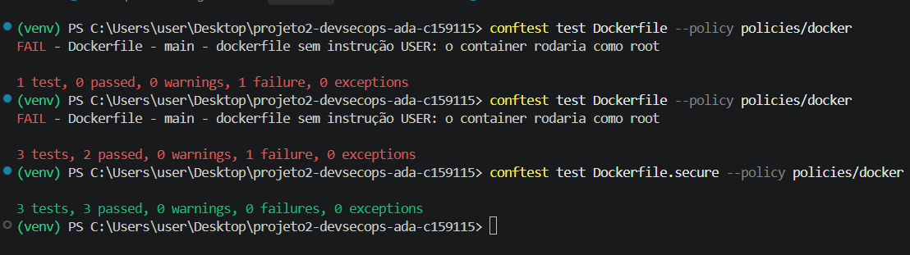
- Criação da pipeline com implementação inicial até fase 2 Inventário
- Teste inicial da pipeline com Dockerfile inseguro - evidência de falha ao usar imagem com usuário ROOT
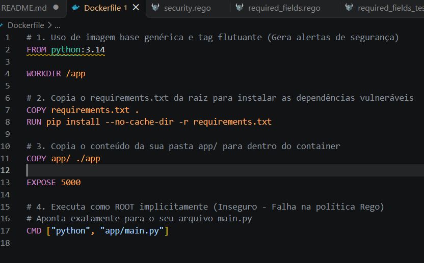
e na pipeline:
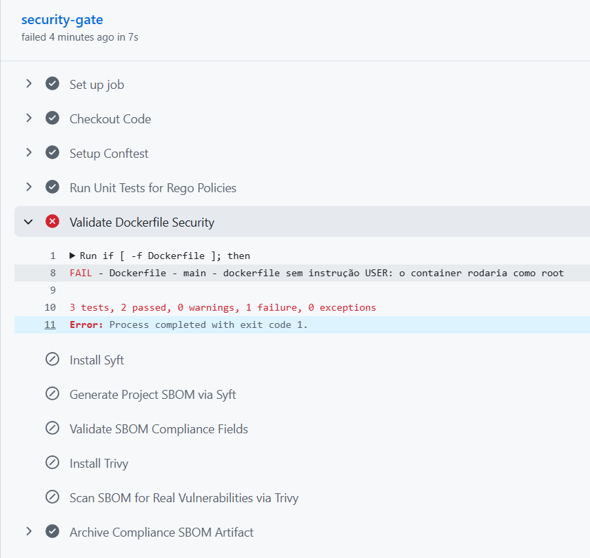
evidencia da aplicação da policy .rego:
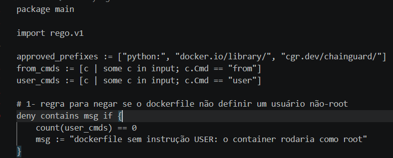
- Fazendo a mudança na nomeclatura do Dockerfile.secure para Dockerfile e mudando o nome do Dockerfile (inseguro) para Dockerfile.antigo, a esteira reconheceu o novo Dockerfile para analisar e tivemos esses retornos:
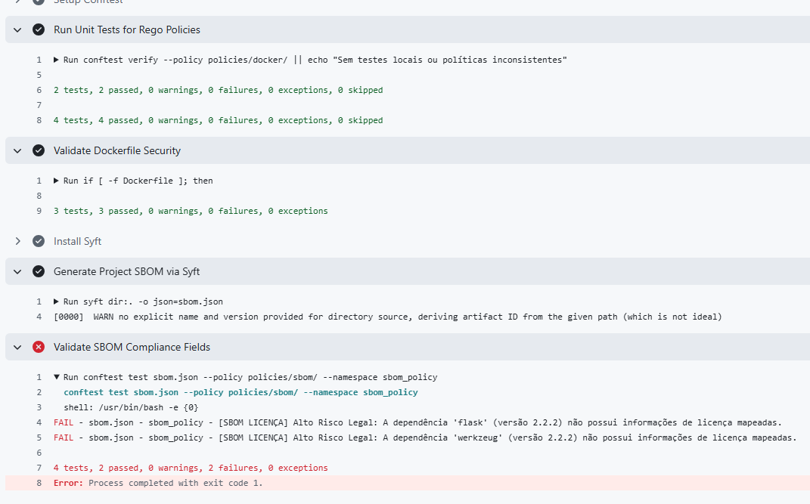
Os testes de security.rego atestaram a conformidade, porém em required_fields.rego houve a indicação de inconformidade de:
FAIL - sbom.json - sbom_policy - [SBOM LICENÇA] Alto Risco Legal: A dependência 'flask' (versão 2.2.2) não possui informações de licença mapeadas.
FAIL - sbom.json - sbom_policy - [SBOM LICENÇA] Alto Risco Legal: A dependência 'werkzeug' (versão 2.2.2) não possui informações de licença mapeadas.
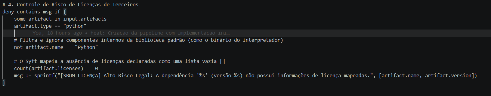
- Dockerfile atualizado:
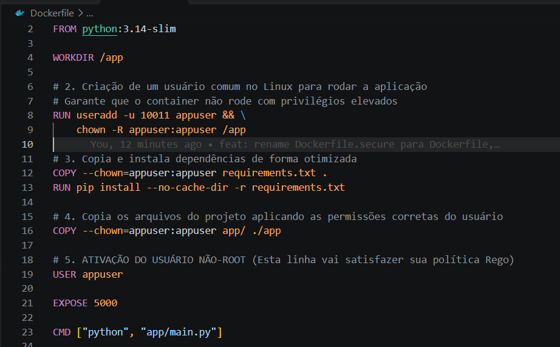
- foi mapeada uma dependencia transitiva do Flask:
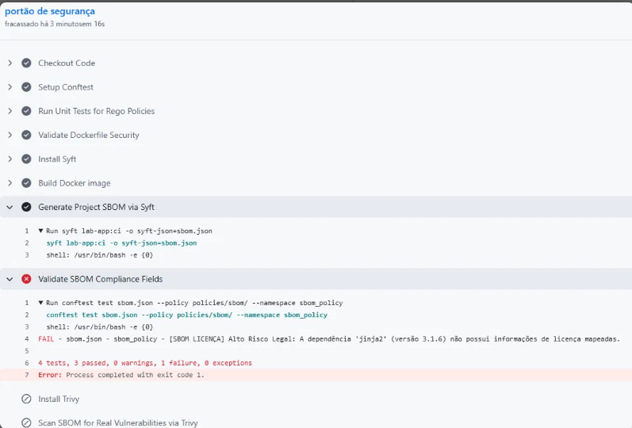
Será feito um debug para catalogar dependências transitivas para colocar como exceção para não travar os passos seguintes
- No pipeline capturada essa dependencia transitiva:
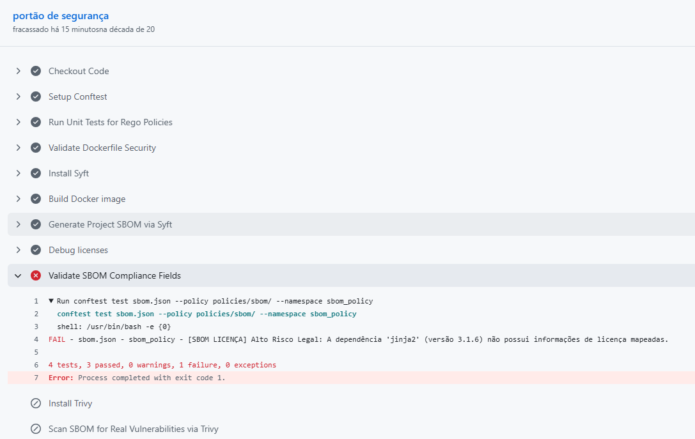
Feito tratamento dessa exceção em required_fields.rego
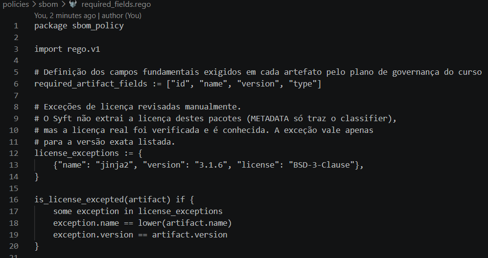
- Feito um ajuste de checagem de versão do Trivy e geração de um segundo SBOM compatível para o Trivy interpretar, na saída da esteira tivemos `Detected SBOM format    format="unknown"
FATAL ... SBOM decode error: unknown scanning is not yet supported`
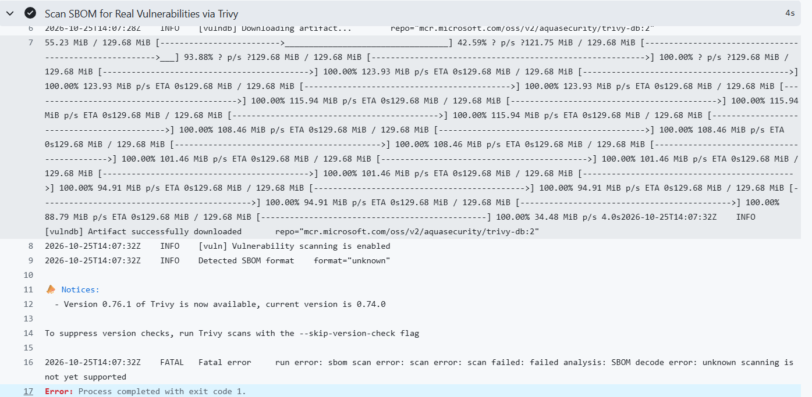
- Nesse projeto python foi instalado via pip o pip-audit e abaixo temos apontamentos de vulnerabilidades desse projeto:
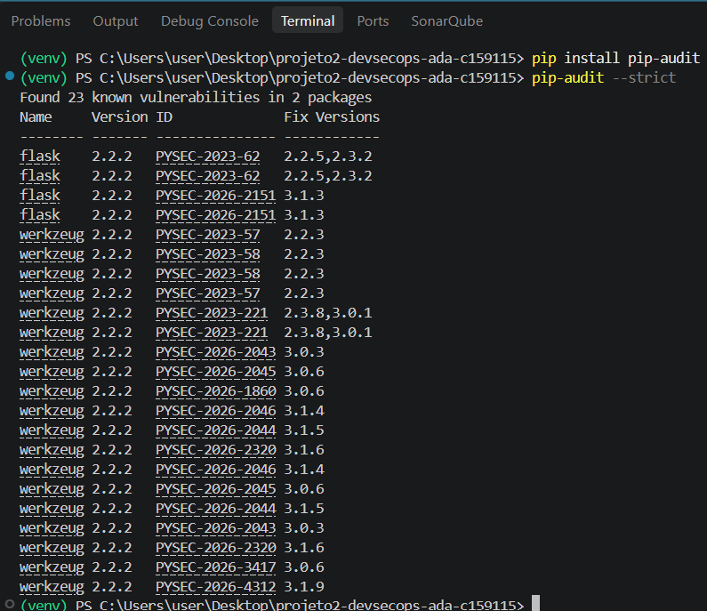
No pipeline também temos evidências de vulnerabilidades pelo sbom no formato cyclonedx
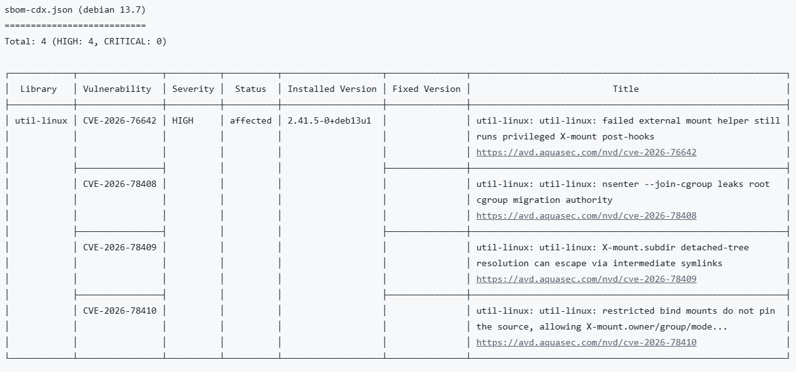
- Atualização do script devsecops.yml para assinatura do cosign keyless, verificação da legitimidade da imagem, simulação de ataque com alteração da imagem docker e coleta de evidência no arquivo cosign-evidence.txt
## Mapa de Ameaças

Onde um atacante entraria na cadeia deste projeto e qual controle do curso bloqueia ou apenas evidencia o ataque.

| # | Ponto de entrada | Ataque simulado ou possível | Controle | Efeito | Evidência no projeto |
|---|---|---|---|---|---|
| 1 | Dockerfile | Container rodando como root, tag `latest` | Rego + Conftest (`security.rego`) | **Bloqueia** | `Dockerfile.antigo` reprovado na pipeline; `Dockerfile` seguro aprovado |
| 2 | Dependências Python | Pacote sem licença mapeada (risco legal e de procedência) | Policy de SBOM (`required_fields.rego`) | **Bloqueia** | FAIL de `flask` e `werkzeug` antes do ajuste |
| 3 | Imagem base e bibliotecas | CVE conhecida explorável | Syft + Trivy | **Evidencia** | 4 CVEs HIGH em `util-linux 2.41.5-0+deb13u1` (Debian 13.7), sem correção disponível |
| 4 | Registry | Imagem adulterada publicada no lugar da legítima | Cosign keyless (`cosign verify`) | **Bloqueia** na verificação | Imagem adulterada: `no signatures found` |
| 5 | Origem do artefato | Imagem "legítima" construída fora da pipeline | Identidade do certificado (OIDC) + Rekor | **Evidencia** | Subject `devsecops.yml@refs/heads/main`, trigger `push`, `logIndex 3515269428` |
| 6 | Dependência maliciosa | Código malicioso em pacote (caso xz-utils) | SBOM (Syft, CycloneDX) + attestation | **Evidencia** | `sbom.json`, `sbom-cdx.json` e attestation CycloneDX válida |
| 7 | Pipeline de CI | Build comprometido (caso SolarWinds) | Assinatura atrelada ao workflow e ao commit | **Evidencia** | `githubWorkflowSha 0d8976dd…`, digest imutável |

**Casos reais relacionados**
- **SolarWinds (2020):** o build legítimo foi comprometido e o artefato adulterado saiu assinado. No projeto, a imagem adulterada (linha 4) é o análogo mais simples: um artefato diferente do original se passando por ele. O Cosign detecta quando a assinatura não existe, mas não protege contra um build comprometido que assina o próprio resultado. Por isso a identidade do workflow, o commit e o log de transparência são evidência importante (linhas 5 e 7).
- **xz-utils (2024):** backdoor inserido em uma dependência por um mantenedor. Um SBOM não impede isso, mas permite responder rápido "estou usando essa versão?" (linha 6).

**Riscos residuais**
- As actions estão referenciadas por tag, não por SHA, e o Syft é instalado a partir da branch `main`.
- A assinatura prova a origem da imagem, não a ausência de vulnerabilidades.

---

## Passo 4 — Compliance: que evidência eu teria se a cadeia fosse atacada amanhã?

Se alguém questionasse amanhã se a imagem em produção é a que saiu da minha pipeline, eu teria evidências verificáveis de forma independente em três frentes.

**1. Procedência (quem e como gerou).** A imagem publicada tem o digest imutável `sha256:d6084888b78e…f1f7`, assinado via Cosign keyless. A verificação (`cosign-evidence.txt`) confirma que o certificado foi emitido pelo GitHub Actions para o workflow `devsecops.yml` do repositório, na branch `main`, disparado por `push`, no commit `0d8976dd949183cb73ffcbc4972a0527606c0e76`. Como a assinatura está no log de transparência Rekor (`logIndex 3515269428`), ela tem registro público com data, que não depende de um arquivo meu e não pode ser alterado depois.

**2. Composição (o que havia dentro).** O SBOM em CycloneDX (`sbom-cdx.json`) está anexado à imagem como attestation assinada, cuja verificação também passou, e uma cópia está versionada no repositório. Isso permite responder rapidamente se um componente afetado estava na imagem. O scan do Trivy sobre esse SBOM mostrou 4 CVEs HIGH em `util-linux 2.41.5-0+deb13u1` (CVE-2026-76642, CVE-2026-78408, CVE-2026-78409 e CVE-2026-78410), todas sem correção disponível, o que documenta o risco conhecido no momento do build.

**3. Detecção de adulteração.** A simulação de ataque mostrou o comportamento esperado: uma imagem derivada da legítima, com backdoor e digest diferente (`sha256:cbba91517e6b…4010`), foi rejeitada com `no signatures found`. Em um incidente real, qualquer imagem em execução sem assinatura válida com a identidade do meu workflow seria tratada como suspeita.

**Limitações.** As evidências provam origem e composição, não ausência de falhas. O Trivy ainda não bloqueia o build, e um build comprometido que assinasse o próprio resultado não seria barrado pela assinatura; nesse caso a evidência serviria para reconstruir o que aconteceu (qual workflow, qual commit, quando). Os artifacts da pipeline expiram em 14 dias, por isso as evidências principais (`cosign-evidence.txt` e `sbom-cdx.json`) foram versionadas no repositório. 

** cosign-evidence.txt:
=== VERIFICAÇÃO DA IMAGEM LEGÍTIMA ===
Imagem: ghcr.io/xtremeboombox1/projeto2-devsecops-ada-c159115@sha256:d6084888b78ec3c12d09608f54c2ebad6d697f300ce2ef95460590e0d164f1f7

Verification for ghcr.io/xtremeboombox1/projeto2-devsecops-ada-c159115@sha256:d6084888b78ec3c12d09608f54c2ebad6d697f300ce2ef95460590e0d164f1f7 --
The following checks were performed on each of these signatures:
  - The cosign claims were validated
  - Existence of the claims in the transparency log was verified offline
  - The code-signing certificate was verified using trusted certificate authority certificates

[{"critical":{"identity":{"docker-reference":"ghcr.io/xtremeboombox1/projeto2-devsecops-ada-c159115"},"image":{"docker-manifest-digest":"sha256:d6084888b78ec3c12d09608f54c2ebad6d697f300ce2ef95460590e0d164f1f7"},"type":"cosign container image signature"},"optional":{"1.3.6.1.4.1.57264.1.1":"https://token.actions.githubusercontent.com","1.3.6.1.4.1.57264.1.2":"push","1.3.6.1.4.1.57264.1.3":"0d8976dd949183cb73ffcbc4972a0527606c0e76","1.3.6.1.4.1.57264.1.4":"DevSecOps Supply Chain Pipeline","1.3.6.1.4.1.57264.1.5":"xtremeboombox1/projeto2-devsecops-ada-c159115","1.3.6.1.4.1.57264.1.6":"refs/heads/main","Bundle":{"SignedEntryTimestamp":"MEYCIQDymewuemOaaMG2ggh1PQ4oFFmJHaau9+3s/7LEvToa5gIhALWcx+q7A2AvyzPrknDxU7Pul6d49ujVqoOJNVAZKDtN","Payload":{"body":"eyJhcGlWZXJzaW9uIjoiMC4wLjEiLCJraW5kIjoiaGFzaGVkcmVrb3JkIiwic3BlYyI6eyJkYXRhIjp7Imhhc2giOnsiYWxnb3JpdGhtIjoic2hhMjU2IiwidmFsdWUiOiJmOWE2OTkzY2Q0MzMyNjQ4NzFiMTIzNzhiNDJmN2Q1ZjliMDEzMjI1MzljMzNlYmM4ZWU0OGYxYmQ5OWJmNzc4In19LCJzaWduYXR1cmUiOnsiY29udGVudCI6Ik1FVUNJUUNubjZVeGNnS0hYTkhCdE9ZMEFXc0VzV3dYOFhXTWlzREM1am40aUtXU3pBSWdiK2dlbXQrNDd1djdqOHc5UXluUTVuVHFvM0tTamhHNWRnems5SUExQU04PSIsInB1YmxpY0tleSI6eyJjb250ZW50IjoiTFMwdExTMUNSVWRKVGlCRFJWSlVTVVpKUTBGVVJTMHRMUzB0Q2sxSlNVaDNla05EUWpCdFowRjNTVUpCWjBsVlYzSnVVVlJ5VVRCV2FtUk9TbE0yYVZoNGIzUk5WV3RtT1VWRmQwTm5XVWxMYjFwSmVtb3dSVUYzVFhjS1RucEZWazFDVFVkQk1WVkZRMmhOVFdNeWJHNWpNMUoyWTIxVmRWcEhWakpOVWpSM1NFRlpSRlpSVVVSRmVGWjZZVmRrZW1SSE9YbGFVekZ3WW01U2JBcGpiVEZzV2tkc2FHUkhWWGRJYUdOT1RXcFplRTFFU1ROTlZFVXdUMVJGZVZkb1kwNU5hbGw0VFVSSk0wMVVSVEZQVkVWNVYycEJRVTFHYTNkRmQxbElDa3R2V2tsNmFqQkRRVkZaU1V0dldrbDZhakJFUVZGalJGRm5RVVYxV1VzeldqUkZNamRwWkcxMVRsRllNV1ZISzI4MWRESkxWVFZPT1U1M1QzRjJXWFlLWVV3M1QzaEZNRlp2ZWpoWlEyaHdhazVGT1VsV2MwWldPVUpyVkdsVWIzaGlNMHd3UVVGcWVtOU5hVGxJVEdoNFpFdFBRMEp0WjNkbloxcHJUVUUwUndwQk1WVmtSSGRGUWk5M1VVVkJkMGxJWjBSQlZFSm5UbFpJVTFWRlJFUkJTMEpuWjNKQ1owVkdRbEZqUkVGNlFXWkNaMDVXU0ZOTlJVZEVRVmRuUWxSbUNqQXJibEJXYVZGU2JIWnRiekpQYTI5V1lVeEhUR2hvYTFCNlFpdENaMDVXU0ZKRlFrRm1PRVZrUkVKNWFHNUNiMlJJVW5kamVtOTJUREprY0dSSGFERUtXV2sxYW1JeU1IWmxTRko1V2xjeGJGbHRPWFppVjBwMlpVUkZkbU5JU25aaGJWWXdZbnBKZEZwSFZqSmpNbFpxWWpOQ2VreFhSbXRaVXpGcVRWUlZOUXBOVkVVeFRIazFibUZZVW05a1YwbDJaREk1ZVdFeVduTmlNMlI2VERKU2JHUnVUbXhaTWpsM1kzazFOV0pYZUVGamJWWnRZM2s1YjFwWFJtdGplVGwwQ2xsWGJIVk5SR3RIUTJselIwRlJVVUpuTnpoM1FWRkZSVXN5YURCa1NFSjZUMms0ZG1SSE9YSmFWelIxV1ZkT01HRlhPWFZqZVRWdVlWaFNiMlJYU2pFS1l6SldlVmt5T1hWa1IxWjFaRU0xYW1JeU1IZEZaMWxMUzNkWlFrSkJSMFIyZWtGQ1FXZFJSV05JVm5waFJFRXlRbWR2Y2tKblJVVkJXVTh2VFVGRlJBcENRMmQzV2tSbk5VNTZXbXRhUkdzd1QxUkZORTB5VG1sT2VrNXRXbTFPYVZsNlVUVk9la3BvVFVSVmVVNTZXWGRPYlUxM1dsUmpNazFETUVkRGFYTkhDa0ZSVVVKbk56aDNRVkZSUlVnd1VteGtiRTVzV1RBNWQyTjVRbFJrV0VKM1lraHJaMUV5YUdoaFZ6Um5WVWRzZDFwWGVIQmliVlYzVDNkWlMwdDNXVUlLUWtGSFJIWjZRVUpDVVZGMFpVaFNlVnBYTVd4WmJUbDJZbGRLZG1WRVJYWmpTRXAyWVcxV01HSjZTWFJhUjFZeVl6SldhbUl6UW5wTVYwWnJXVk14YWdwTlZGVTFUVlJGTVUxQ01FZERhWE5IUVZGUlFtYzNPSGRCVVZsRlJETktiRnB1VFhaaFIxWm9Xa2hOZG1KWFJuQmlha0UzUW1kdmNrSm5SVVZCV1U4dkNrMUJSVWxDUXpCTlN6Sm9NR1JJUW5wUGFUaDJaRWM1Y2xwWE5IVlpWMDR3WVZjNWRXTjVOVzVoV0ZKdlpGZEtNV015Vm5sWk1qbDFaRWRXZFdSRE5Xb0tZakl3ZDJkWlFVZERhWE5IUVZGUlFtYzNPSGRCVVd0RlkyZDRkMkZJVWpCalNFMDJUSGs1Ym1GWVVtOWtWMGwxV1RJNWRFd3phREJqYlZaMFdsZEtkZ3BpTWpGcFlqTm5lRXd6UW5saU1uQnNaRWM0ZVV4WFVteGtiazVzV1RJNWQyTjVNV2hhUjBWMFdYcEZNVTlVUlhoT1V6aDFXakpzTUdGSVZtbE1NMlIyQ21OdGRHMWlSemt6WTNrNWExcFlXbnBhVjA1MlkwaE5kV1ZYTVhOUlNFcHNXbTVOZG1GSFZtaGFTRTEyWWxkR2NHSnFRVFJDWjI5eVFtZEZSVUZaVHk4S1RVRkZTMEpEYjAxTFJFSnJUMFJyTTA1dFVtdFBWRkUxVFZSbmVsa3lTVE5OTWxwdFdUSkthazVFYXpOTmJVVjNUbFJKTTA1cVFUSlpla0pzVG5wWmR3cElVVmxMUzNkWlFrSkJSMFIyZWtGQ1EzZFJVRVJCTVc1aFdGSnZaRmRKZEdGSE9YcGtSMVpyVFVaQlIwTnBjMGRCVVZGQ1p6YzRkMEZSZDBWUlozaEJDbUZJVWpCalNFMDJUSGs1Ym1GWVVtOWtWMGwxV1RJNWRFd3phREJqYlZaMFdsZEtkbUl5TVdsaU0yZDRURE5DZVdJeWNHeGtSemg1VEZkU2JHUnVUbXdLV1RJNWQyTjVNV2hhUjBWMFdYcEZNVTlVUlhoT1ZFRTBRbWR2Y2tKblJVVkJXVTh2VFVGRlRrSkRiMDFMUkVKclQwUnJNMDV0VW10UFZGRTFUVlJuZWdwWk1ra3pUVEphYlZreVNtcE9SR3N6VFcxRmQwNVVTVE5PYWtFeVdYcENiRTU2V1hkSWQxbExTM2RaUWtKQlIwUjJla0ZDUkdkUlVrUkJPWGxhVjFwNkNrd3lhR3haVjFKNlRESXhhR0ZYTkhkSFoxbExTM2RaUWtKQlIwUjJla0ZDUkhkUlRVUkJiM2hPUkUxNVRWUlZNMDFxWXpKTlJFVkhRMmx6UjBGUlVVSUtaemM0ZDBGU1FVVkpkM2RvWVVoU01HTklUVFpNZVRsdVlWaFNiMlJYU1hWWk1qbDBURE5vTUdOdFZuUmFWMHAyWWpJeGFXSXpaM2hOUW10SFEybHpSd3BCVVZGQ1p6YzRkMEZTUlVWRGQzZEtUVlJWTWs1VVRYZE5ha1V3VFVsSFFVSm5iM0pDWjBWRlFWbFBMMDFCUlZOQ1NFbE5ZMGRvTUdSSVFucFBhVGgyQ2xveWJEQmhTRlpwVEcxT2RtSlRPVFJrU0Vwc1lsZFdhV0l5T1hSWmJUazBUVk01ZDJOdE9YRmFXRkoyVFdreGExcFlXbnBhVjA1MlkwaE5kRmxYVW1nS1RGZE5lRTVVYTNoTlZGVjJURzFrY0dSSGFERlphVGt6WWpOS2NscHRlSFprTTAxMldrZFdNbU15Vm1waU0wSjZURzVzZEdKRlFubGFWMXA2VERKb2JBcFpWMUo2VERJeGFHRlhOSGRQUVZsTFMzZFpRa0pCUjBSMmVrRkNSWGRSY1VSRFozZGFSR2MxVG5wYWExcEVhekJQVkVVMFRUSk9hVTU2VG0xYWJVNXBDbGw2VVRWT2VrcG9UVVJWZVU1NldYZE9iVTEzV2xSak1rMUNVVWREYVhOSFFWRlJRbWMzT0hkQlVsRkZRbWQzUldOSVZucGhSRUl3UW1kdmNrSm5SVVVLUVZsUEwwMUJSVlpDUjFsTldrZG9NR1JJUW5wUGFUaDJXakpzTUdGSVZtbE1iVTUyWWxNNU5HUklTbXhpVjFacFlqSTVkRmx0T1RSTlV6bDNZMjA1Y1FwYVdGSjJUV2t4YTFwWVducGFWMDUyWTBoTmRGbFhVbWhNVjAxNFRsUnJlRTFVVlhaWlYwNHdZVmM1ZFdONU9YbGtWelY2VEhwUmQwNUVhelJQUkdzMUNrNUVhekJNTWtZd1pFZFdkR05JVW5wTWVrVjNSbWRaUzB0M1dVSkNRVWRFZG5wQlFrWm5VVWxFUVZwM1pGZEtjMkZYVFhkaGQxbExTM2RaUWtKQlIwUUtkbnBCUWtkQlVtUkVSblI1V2xoQ2RrOXVhREJqYlZaMFdsZEtkbUl5TVdsaU0yZDRVVVJGTVU1cVZYcE5SRWw0VGtNNWQyTnRPWEZhV0ZKMlRXa3hhd3BhV0ZwNldsZE9kbU5JVFhSWlYxSm9URmROZUU1VWEzaE5WRlpCVFZSUmVrMXFSVEZPZWtrelRtcHdlVnBYV1RaamJWWnRZM2s1YjFwWFJtdGplVGwwQ2xsWGJIVk5TVWRNUW1kdmNrSm5SVVZCWkZvMVFXZFJRMEpJTUVWbGQwSTFRVWhqUVROVU1IZGhjMkpJUlZSS2FrZFNOR050VjJNelFYRktTMWh5YW1VS1VFc3pMMmcwY0hsblF6aHdOMjgwUVVGQlIyaG1WRVp4WVZGQlFVSkJUVUZUUkVKSFFXbEZRV2RwV2psSllUWkVUVWhtUzNsaFVXdDFaVTVOTVZkSGVBcENTRE13VVZSWWNtRnBRaTlJWmxsU2RVcFZRMGxSUkZWbk5UZGhkMUJVT0RaT1pXRmpRbXRYV1VWM2RFMVZTamhLU0ZGUk5YQnhTR1pUWmxKb1JrTnRDbTlxUVV0Q1oyZHhhR3RxVDFCUlVVUkJkMDV2UVVSQ2JFRnFRbkJ1VFVvelNscEdZMXBJZFRGNFIxcElUM0ZhZVRkM2FEUXplR2xLTkVsM1NIQlpha01LVm00clpIUTJSemczTVdSMlEydzVaRzVqVkROUmNFOXFZemMwUTAxUlJEYzNhVUpzVjNsQmRFSkhSSEZCYXpOQ1RHUkZhM0pPVms5Uk5ESkdZV2RoZHdwRWEwTmhTbFJwYjJsUGFFaDJURWhaZDFOR1VrVlhVWEpVYzJoSVdIVmpQUW90TFMwdExVVk9SQ0JEUlZKVVNVWkpRMEZVUlMwdExTMHRDZz09In19fX0=","integratedTime":1793101753,"logIndex":3515269428,"logID":"c0d23d6ad406973f9559f3ba2d1ca01f84147d8ffc5b8445c224f98b9591801d"}},"Issuer":"https://token.actions.githubusercontent.com","Subject":"https://github.com/xtremeboombox1/projeto2-devsecops-ada-c159115/.github/workflows/devsecops.yml@refs/heads/main","githubWorkflowName":"DevSecOps Supply Chain Pipeline","githubWorkflowRef":"refs/heads/main","githubWorkflowRepository":"xtremeboombox1/projeto2-devsecops-ada-c159115","githubWorkflowSha":"0d8976dd949183cb73ffcbc4972a0527606c0e76","githubWorkflowTrigger":"push"}}]

=== VERIFICAÇÃO DA ATTESTATION DO SBOM ===

Verification for ghcr.io/xtremeboombox1/projeto2-devsecops-ada-c159115@sha256:d6084888b78ec3c12d09608f54c2ebad6d697f300ce2ef95460590e0d164f1f7 --
The following checks were performed on each of these signatures:
  - The cosign claims were validated
  - Existence of the claims in the transparency log was verified offline
  - The code-signing certificate was verified using trusted certificate authority certificates
Certificate subject: https://github.com/xtremeboombox1/projeto2-devsecops-ada-c159115/.github/workflows/devsecops.yml@refs/heads/main
Certificate issuer URL: https://token.actions.githubusercontent.com
GitHub Workflow Trigger: push
GitHub Workflow SHA: 0d8976dd949183cb73ffcbc4972a0527606c0e76
GitHub Workflow Name: DevSecOps Supply Chain Pipeline
GitHub Workflow Repository: xtremeboombox1/projeto2-devsecops-ada-c159115
GitHub Workflow Ref: refs/heads/main
Attestation CycloneDX válida.

=== VERIFICAÇÃO DA IMAGEM ADULTERADA (esperado: FALHAR) ===
Imagem: ghcr.io/xtremeboombox1/projeto2-devsecops-ada-c159115@sha256:cbba91517e6bf3d8b43f9b92f58eac8e15d023d5aaf3b448043f972d14024010
Error: no signatures found
error during command execution: no signatures found
RESULTADO: adulteração detectada, imagem sem assinatura válida.